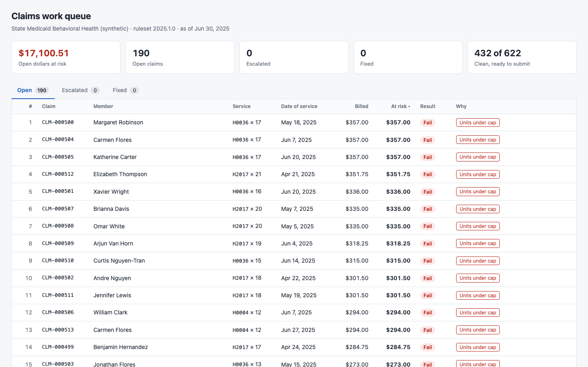
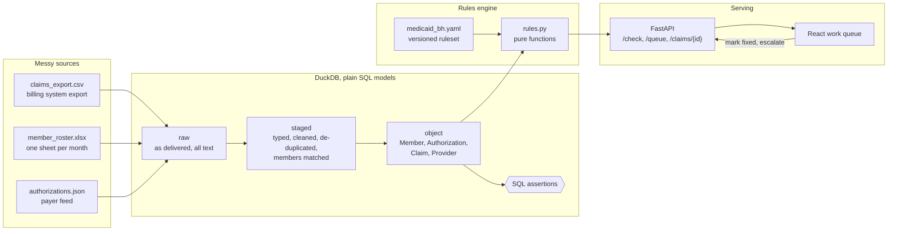
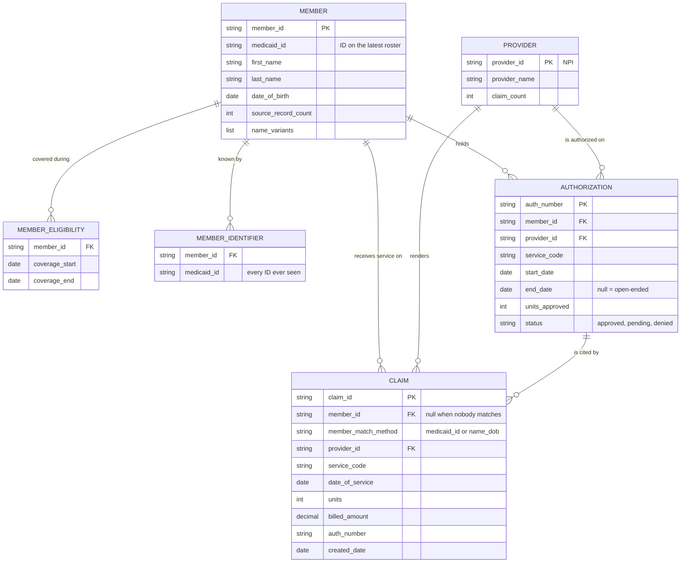

# Claims Denial Triage

Pre-submission claim triage for a small Medicaid behavioral health agency.

## The problem

Small behavioral health agencies lose revenue to denials that were predictable before the claim ever left the building: the member lost eligibility, the authorization expired or ran out of units, the claim was keyed twice, or the filing deadline passed. The facts needed to catch these sit in three places that do not agree with each other — a billing export, a monthly eligibility spreadsheet, and an authorization feed — so nobody checks them together. This project joins those sources into one clean model, runs the payer's rules over every unsubmitted claim, and hands the biller a queue ordered by the dollars at stake.

All data in this repository is synthetic. No real patient, member, provider or claim information is used anywhere.

## Run it

```bash
docker compose up --build
```

Then open:

| | |
|---|---|
| Work queue | http://localhost:8080 |
| API docs | http://localhost:8000/docs |

On first start the API container generates the synthetic source files, runs the pipeline and its data quality assertions, and serves the result. Biller actions are kept in a Docker volume; `docker compose down -v` resets everything.



## Architecture



| Layer | What it does | Where |
|---|---|---|
| Generator | Writes the three source files, seeded and reproducible, with planted defects and an answer key | `src/triage/generator.py` |
| raw | Lands each source untouched, every value as text | `sql/raw/` |
| staged | Parses dates, money and IDs; removes repeated rows; resolves member identities | `sql/staged/` |
| object | The clean model the rules read | `sql/object/` |
| Assertions | One query per expectation; any returned row is a violation | `sql/tests/` |
| Rules | Six payer rules, pass / warn / fail with a reason | `src/triage/rules.py`, `rules/medicaid_bh.yaml` |
| API | Evaluates claims, ranks the queue, records biller actions | `src/triage/api.py`, `src/triage/service.py` |
| UI | Queue table, rule trace, fix and escalate | `ui/` |

## The messy sources

The generator plants the defects a real agency lives with, and writes an answer key (`data/truth/`) that the tests check the pipeline and rules against.

| Source | Defects |
|---|---|
| Claims CSV | Five date formats; amounts with `$` and thousands separators; member IDs with hyphens, padding and dropped leading zeros; names as `LAST, FIRST M.` or `First Last`; rows repeated verbatim; blank and mistyped auth numbers; units over the daily cap; true duplicate claims |
| Roster Excel | Title rows above the header; the same person under nicknames, typos, middle initials and shortened hyphenated surnames; IDs stored as numbers (leading zeros lost) or missing; birth dates as real dates or text; people keyed twice in one month; members re-enrolled under a new ID; twins |
| Authorizations JSON | Nested records; mixed date formats; units as numbers or strings; inconsistent status casing; superseded revisions still in the feed; missing end dates |

## Object model



### Member entity resolution

The roster lists the same person many times, rarely the same way twice. Resolution runs in SQL (`sql/staged/30_member_resolution.sql`):

1. **Normalise.** IDs are reduced to ten digits with leading zeros restored; names are upper-cased and stripped to letters; nicknames map to formal names; birth dates are parsed from every format in use.
2. **Match.** Two roster records are the same person when they share a Medicaid ID, or when the birth date is identical and both first and last names match (exact, close spelling, or one surname being the start of the other).
3. **Cluster.** Matches are chained, so a record with a missing ID and a record under a new ID still land on the same member.

Twins (same surname and birth date, different first names and IDs) stay separate. Claims and authorizations link to a member by ID first, and by name and birth date only when the ID finds nobody and the fallback is unambiguous. A claim that matches nobody is kept with a null member rather than dropped, so the eligibility rule can report it.

## Rules

| Rule | Fails when | Warns when |
|---|---|---|
| Eligibility on date of service | The patient is not on the roster, or has no coverage on the date | The member was matched by name because the ID on the claim is wrong |
| Authorization exists | The service needs an auth and none is on file; the cited number is unknown, denied, or belongs to another member or service | The auth number is missing from the claim but an approved auth is on file; the auth is pending |
| Service inside authorization window | The date of service is before the auth starts or after it ends | — |
| Units under cap | Units exceed the daily cap for the code, or push the auth past its approved units | The auth is 90% or more used |
| Duplicate claim | An earlier claim has the same member, provider, service and date | Same member, service and date under a different provider |
| Timely filing | More than 90 days since the date of service | 15 days or fewer remain |

Thresholds, service codes and the rule list live in `rules/medicaid_bh.yaml`.

**Dollars at risk** is the billed amount weighted by the claim's worst result: 100% for a fail, 25% for a warn (both set in the ruleset). The queue is sorted by it, descending.

## Validation

The answer key comes from this project's own synthetic generator, so the table below confirms that the rules behave as specified on data built to exercise them; it does not show how they would do on real claims. The generator records which defect it planted in which claim and which rule should report it (`data/truth/claims_truth.csv`). The pipeline never reads that file. `triage validate` runs the rules over the built database and compares each result with the key.

| Rule | Defects planted | Defects caught | Clean claims wrongly flagged |
|---|---:|---:|---:|
| Eligibility on date of service | 34 | 34 | 0 |
| Authorization exists | 60 | 60 | 0 |
| Service inside authorization window | 18 | 18 | 0 |
| Units under cap | 33 | 33 | 0 |
| Duplicate claim | 21 | 21 | 0 |
| Timely filing | 24 | 24 | 0 |
| **Total** | **190** | **190** | **0** |

Seed 42, 622 claims: 190 with a planted defect, 432 clean.

- **Planted** is the number of claims the answer key assigns to the rule.
- **Caught** means the rule returned the exact status the key expects, warn or fail. A fail where the key expects a warn does not count.
- **Wrongly flagged** counts clean claims on which the rule returned anything other than pass.

To reproduce:

```bash
triage generate && triage build && triage validate
```

`triage validate` prints the table and exits non-zero if any planted defect is missed or any clean claim is flagged. `tests/test_validation.py` makes the same check on every test run.

## API

| Endpoint | Purpose |
|---|---|
| `POST /check` | Evaluate one claim that is not in the system yet; returns the rule trace |
| `GET /queue` | Claims with findings, ranked by dollars at risk. `work_status` = `open` (default), `escalated`, `fixed`, `all`; optional `limit` |
| `GET /claims/{id}` | One claim with its full rule trace, linked member and authorization, and action history |
| `POST /claims/{id}/actions` | `{"action": "fix" \| "escalate" \| "reopen", "note": "..."}` |
| `GET /health` | Liveness, dataset date, ruleset version |

```bash
curl -s localhost:8000/check -H 'content-type: application/json' -d '{
  "medicaid_id": "0123456789",
  "service_code": "H0004",
  "date_of_service": "2025-06-20",
  "units": 4,
  "billed_amount": 98.00
}'
```

"Mark fixed" records that the biller corrected the claim in the billing system and moves it out of the open queue; the next export re-evaluates it from scratch.

## Development

Requires Python 3.12 and Node 20 or newer.

```bash
python3.12 -m venv .venv && source .venv/bin/activate
pip install -e ".[dev]"

triage generate          # write synthetic sources to data/raw
triage build             # run the SQL pipeline and assertions -> data/triage.duckdb
triage validate          # score the rules against the generator's answer key
pytest                   # rules, entity resolution, pipeline, API, validation
triage serve             # API on :8000

cd ui && npm install && npm run dev    # UI on :5173, proxied to the API
```

The synthetic dataset is anchored to 30 June 2025, and the API evaluates timely filing as of that date so the results do not drift as the calendar moves. Set `TRIAGE_AS_OF=YYYY-MM-DD` to evaluate as of another day.

## Design decisions

### Why rules are pure functions

Each rule is a function of `(claim, context, parameters)` that returns a status and a reason. `rules.py` imports only the standard library: no database, no web framework, no YAML parser, no clock. A test enforces that.

- **Testable in isolation.** A rule test builds a claim and a few facts in memory and asserts the result. There is no database to seed and nothing to mock, which is why every boundary (the last covered day, the 90th day, the unit that tips an auth over) has its own test.
- **Deterministic.** The evaluation date is an input, never read from the system. The same claim and facts always produce the same trace, so a result can be reproduced months later when a denial is disputed.
- **One implementation, many callers.** `POST /check`, the evaluation of the whole queue, and the test suite all call the same functions. There is no second copy of the logic in SQL or in the UI to fall out of step.
- **Explainable.** A rule cannot return a status without a reason, so the trace a biller reads is produced by the same code path that made the decision.
- **Portable.** Because the rules know nothing about DuckDB or FastAPI, either can be replaced without touching payer logic.

### Why rules are versioned

Payer policy changes: filing limits move, codes start requiring authorization, unit caps are revised. Policy therefore lives in a YAML file with an explicit `version` and `effective_date`, kept in git, rather than in constants scattered through code.

- **Every result names its policy.** The ruleset version is stamped on every trace and API response. "Why did this pass last month and fail today?" has a checkable answer: the data changed, or the version did.
- **Policy changes are reviewable.** Raising a threshold is a one-line diff in a file a billing lead can read, with a changelog entry, not a code change.
- **Auditable history.** Checking out an old version of the file reproduces what the system would have said under the old policy.
- **Safe to change.** The loader rejects unknown rule names, duplicates and missing fields at startup, so a bad edit fails loudly instead of silently skipping a check.

### Other choices

- **DuckDB and plain SQL.** The data is small and file-based. One embedded database reads CSV and JSON directly and needs no server; plain `.sql` files keep each transformation readable by anyone who knows SQL. The Excel roster is the one source read in Python, because spreadsheet cells are typed and must be flattened to text first.
- **Raw is kept as delivered.** Nothing is cleaned on the way in, so any surprising result can be traced back to the exact source row.
- **Assertions are queries.** Each file in `sql/tests/` selects the rows that violate an expectation. Error-level violations stop the build; warn-level ones (for example, claims whose patient is not on the roster) are reported and left for the rules to surface.
- **Unmatched claims are kept.** Dropping a claim because its member could not be resolved would hide exactly the claim most likely to be denied.
